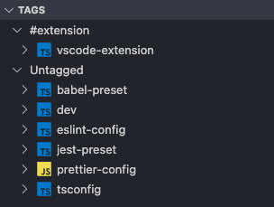

import { TypeLabel } from "@/components/TypeLabel";

The **moon console** extension brings moon into VS Code. Browse your projects and their tasks, run
them with a click, review the results of the last run, and explore the project, task, and action
graphs, all without leaving the editor. It also validates moon's configuration files as you type,
and makes moon's [MCP server](../guides/mcp.mdx) available to AI agents in VS Code.

## Installation

Install the extension from the
[Visual Studio Marketplace](https://marketplace.visualstudio.com/items?itemName=moonrepo.moon-console),
or from [Open VSX](https://open-vsx.org/extension/moonrepo/moon-console) for editors that use it,
like VSCodium. You can also search for "moon console" in the Extensions view, or install it from
the command line:

```shell
$ code --install-extension moonrepo.moon-console
```

The extension requires:

- **VS Code 1.103 or later.**
- **moon** - [Installed](../index.mdx) in the repository, or globally on your `PATH`.
- **The [YAML extension](https://marketplace.visualstudio.com/items?itemName=redhat.vscode-yaml)**
  by Red Hat, which is installed automatically, and powers
  [configuration validation](#configuration-validation).

The extension activates when the opened folder contains a `.moon` or `.config/moon` directory, or a
`moon.*` file. To have everyone on your team prompted to install it, add it to the repository's
recommended extensions:

```json title=".vscode/extensions.json"
{
  "recommendations": ["moonrepo.moon-console"]
}
```

## Views

Click the moon icon in the activity bar to open the moon console, which contains the projects,
tags, and last run views. The projects view is also available at the bottom of the Explorer
sidebar, under "moon".

### Projects

The projects view lists every project in the workspace, grouped by their
[stack](<../(fundamentals)/project.mdx#stacks>) and [layer](<../(fundamentals)/project.mdx#layers>),
like "Frontend applications" or "Libraries". Projects with neither are grouped under "Other", and
when every project is in the same group, they're listed without one. Each project's icon reflects
its [language](<../(fundamentals)/project.mdx#language>), and hovering it shows the title and
description from its [metadata](<../(fundamentals)/project.mdx#metadata>).

<div style={{ maxWidth: 300 }}>
  
</div>

Expand a project to see its tasks, along with each task's command. The icon reflects the task's
[type](<../(fundamentals)/task.mdx#types>): a wrench for build tasks, a beaker for test tasks, and a
terminal for run tasks. [Internal tasks](<../(fundamentals)/task.mdx#internal-only>) are never shown,
and others can be hidden with the [`moon.hideTasks`](#settings) setting.

Hover a project or task to reveal its actions:

- **Run the task** (on a task) - Runs [`moon run`](../commands/run.mdx) for the task, in a terminal.
- **View project** (on a project) - Opens the project's [`moon.config`](<../(fundamentals)/project.mdx>)
  file, or reveals its folder when it doesn't have one.
- **Check project** (on a project) - Runs [`moon check`](../commands/check.mdx) for the project,
  which runs all of its build and test tasks.

The view's toolbar can refresh the list of projects, and open the [graphs](#commands). Projects are
also refreshed automatically when a file in `.moon`, or a `moon.*` file, is changed.

### Tags

The tags view lists the same projects, grouped by their [tags](<../(fundamentals)/project.mdx#tags>)
instead, with a group for projects without any tags. A project with multiple tags is listed under
each of them. Projects and tasks have the same actions as in the projects view.

<div style={{ maxWidth: 300 }}>
  
</div>

### Last run

The last run view summarizes the most recent run of [`moon run`](../commands/run.mdx),
[`moon check`](../commands/check.mdx), or [`moon exec`](../commands/exec.mdx), whether it was
started from the editor or the command line. It shows the targets that ran and the total duration,
followed by every [action](<../(fundamentals)/action.mdx>) in the run, like setting up toolchains,
installing dependencies, and running tasks, with each action's status and duration.

The view reads the report that moon writes to `.moon/cache/runReport.json`, and updates whenever
it changes. [`moon ci`](../commands/ci.mdx) writes a separate report, so CI runs aren't shown.

## Commands

The following commands are available from the Command Palette (<kbd>Cmd</kbd>+<kbd>Shift</kbd>+<kbd>P</kbd>
on macOS, or <kbd>Ctrl</kbd>+<kbd>Shift</kbd>+<kbd>P</kbd> on Windows and Linux):

- **moon: Run one or many tasks** - Prompts for one or more [targets](<../(fundamentals)/target.mdx>),
  separated by spaces, like `app:build :lint`, and runs them with [`moon run`](../commands/run.mdx)
  in a terminal.
- **moon: View project graph**, **moon: View task graph**, and **moon: View action graph** - Opens
  an interactive visualization of the [project graph](<../(fundamentals)/project-graph.mdx>),
  [task graph](<../(fundamentals)/task-graph.mdx>), or [action graph](<../(fundamentals)/action-graph.mdx>)
  in an editor tab, like the [`moon project-graph`](../commands/project-graph.mdx) command does in a
  browser. The visualizer is loaded from the internet, so it requires a connection.
- **moon: Append YAML schemas configuration to settings** - Configures YAML validation to use your
  workspace's schemas (see [configuration validation](#configuration-validation)).
- **moon: Open settings** - Opens VS Code's settings, filtered to the extension's
  [settings](#settings).

Commands that run moon only appear once the extension has found moon's binary.

## Configuration validation

With the YAML extension installed, moon's YAML configuration files are validated as you type, with
autocompletion and descriptions for each setting. Out of the box, the extension validates them with
generic schemas, which don't know about your workspace's toolchain and extension settings.

For accurate validation, run **moon: Append YAML schemas configuration to settings**. It adds a
`yaml.schemas` setting to `.vscode/settings.json` that maps each configuration file to the schemas
moon generates for your workspace in `.moon/cache/schemas`, like the following:

```json title=".vscode/settings.json"
{
  "yaml.schemas": {
    "./.moon/cache/schemas/project.json": ["**/moon.yml"],
    "./.moon/cache/schemas/tasks.json": [
      ".moon/tasks.yml",
      ".moon/tasks/**/*.yml"
    ],
    "./.moon/cache/schemas/toolchains.json": [".moon/toolchains.yml"],
    "./.moon/cache/schemas/workspace.json": [".moon/workspace.yml"]
  }
}
```

The schemas are generated when moon runs tasks, or on demand with
[`moon sync config-schemas`](../commands/sync/config-schemas.mdx). The generated settings only match
files with the `.yml` extension in a `.moon` directory. For other formats, or a `.config/moon`
directory, reference the schemas yourself (see
[schema validation](<../(fundamentals)/config.mdx#schema-validation>)).

## AI agents (MCP)

The extension registers moon's [MCP server](../guides/mcp.mdx) with VS Code, so AI agents in chat,
like GitHub Copilot, can read your projects, tasks, templates, and changed files, sync the
workspace, and generate code, without any configuration (see the
[available tools](../guides/mcp.mdx#available-tools)). It starts [`moon mcp`](../commands/mcp.mdx)
with the workspace folder as the workspace root, using the `moon` binary on your `PATH`.

To use it, start a chat in agent mode, and enable moon's tools with **Configure Tools** in the chat
input. If you'd rather configure the server yourself, see the [MCP guide](../guides/mcp.mdx#vs-code).

## Settings

The following settings are available, and can be configured per user, or per repository in
`.vscode/settings.json`:

- `moon.binPath` <TypeLabel type="string" /> - Path to the moon binary, relative to moon's
  workspace root, or absolute. On Windows, `.exe` is appended automatically. When no binary exists
  at this path, the extension looks for `moon` on your `PATH`. Defaults to
  `node_modules/@moonrepo/cli/moon`.
- `moon.hideTasks` <TypeLabel type="string[]" /> - Tasks to hide in the projects and tags views,
  as targets: `app:build` hides a single task, `:build` (or `*:build`) hides a task in every project,
  and `app:` (or `app:*`) hides every task in a project. Defaults to `[]`.
- `moon.logLevel` <TypeLabel type="off | error | warn | info | debug | trace | verbose" /> - The
  [log level](../commands/overview.mdx#logging) passed to every command the extension runs, with
  `--log`. Defaults to `info`.
- `moon.rootPrefixes` <TypeLabel type="string[]" /> - Directories, relative to the folder opened in
  VS Code, to look for moon's workspace root in, when moon isn't initialized at the root of the
  folder. The folder itself is always checked last. Defaults to `[]`.

```json title=".vscode/settings.json"
{
  "moon.rootPrefixes": ["frontend"],
  "moon.hideTasks": [":format", "docs:"]
}
```

## Troubleshooting

- **"Unable to find the workspace root"** - The extension finds moon's workspace from the file in
  the active editor, so open a file in the repository first. It looks for a `.moon` or
  `.config/moon` directory at the root of the file's VS Code workspace folder, or in each of the
  [`moon.rootPrefixes`](#settings), so if moon is initialized in a subdirectory, add it there. In a
  multi-root workspace, the views switch to the moon workspace of the folder you're editing in.
- **"Unable to find moon's binary"** - Make sure `moon` is on your `PATH`, which is the case when
  it's installed with proto or an install script, or set [`moon.binPath`](#settings) to its
  location. VS Code may need to be restarted to pick up changes to `PATH`.
- **Projects are out of date** - Changes to existing configuration files refresh the views
  automatically, but adding or removing files doesn't, so use the refresh button in the view's
  toolbar.
- **Something else** - The extension logs what it's doing to the "moon" channel of the Output
  panel (**View > Output**), including where it found the workspace root and binary. Raising
  [`moon.logLevel`](#settings) adds more detail to the output of commands it runs.
