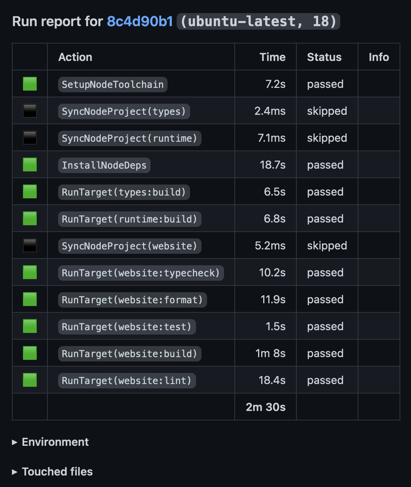

import { ConfigTabs } from "@/components/ConfigTabs";
import { Tab, Tabs } from "fumadocs-ui/components/tabs";

All companies and projects rely on continuous integration (CI) to ensure high quality code and to
avoid regressions. Because this is such a critical piece of every developer's workflow, we wanted to
support it as a first-class feature within moon, and we do just that with the
[`moon ci`](../commands/ci.mdx) command.

## How it works

The [`moon ci`](../commands/ci.mdx) command does all the heavy lifting necessary for effectively
running jobs. It achieves this by automatically running the following steps:

- Determines changed files by comparing a head revision against a base revision (see
  [comparing revisions](#comparing-revisions)).
- Determines which [targets](<../(fundamentals)/target.mdx>) are affected by those changed files,
  and filters out tasks that shouldn't [run in CI](#configuring-tasks-to-run).
- Additionally runs the dependencies of affected tasks, and their direct dependents, to catch
  regressions in the tasks that build on what changed.
- Generates an [action graph](<../(fundamentals)/action-graph.mdx>), syncs the workspace, and sets
  up the [toolchains](<../(fundamentals)/toolchain.mdx>) each running task requires.
- Runs all [actions](<../(fundamentals)/action.mdx>) within the graph in parallel, continuing past
  failures so that a single broken task doesn't hide the results of the others.
- Displays a detailed summary of all passed, failed, and skipped actions, and writes a
  [report](#reporting-run-results).

When the CI provider supports it (GitHub Actions, Buildkite, Azure Pipelines, TeamCity, and Travis
CI), each of these steps is printed within a collapsible log group. For the full list of options,
refer to the [`moon ci`](../commands/ci.mdx) command.

## Configuring tasks to run

Not every task belongs in CI. Development servers never complete, and one-off scripts like
formatters or deploys may not make sense on every pull request. When
[`options.runInCI`](/moon/api/TaskOptionsConfig#runinci) isn't configured, moon decides based on the
task's [type](<../(fundamentals)/task.mdx#types>):

- `build` and `test` tasks run in CI, which covers building, linting, typechecking, testing, and so
  on.
- `run` tasks, [persistent](<../(fundamentals)/task.mdx#persistent>) tasks, and
  [interactive](<../(fundamentals)/task.mdx#interactive>) tasks don't run in CI. Tasks named `dev`,
  `start`, or `serve` receive the [`server` preset](<../(fundamentals)/task.mdx#server>), which
  makes them persistent, so they're local only by default.

To change this per task, set [`options.runInCI`](/moon/api/TaskOptionsConfig#runinci) to one of the
following values:

- `true` or `"affected"` - Run in CI when affected by changed files.
- `false` - Never run in CI.
- `"always"` - Always run in CI, even when not affected, like a smoke test that should run on every
  pull request.
- `"only"` - Only run in CI when affected, and never locally.
- `"skip"` - Don't run in CI, but still allow tasks that run in CI to depend on it. Runs locally as
  usual.

<ConfigTabs
  file="moon"
  config={{
    tasks: {
      format: {
        command: "prettier --write .",
        options: {
          runInCI: false,
        },
      },
      smoke: {
        command: "playwright test --grep @smoke",
        options: {
          runInCI: "always",
        },
      },
    },
  }}
/>

<Callout type="warning">
  A task that runs in CI can't depend on a task that doesn't, as the pipeline
  wouldn't be able to run it correctly, so moon errors when building the tasks.
  Either enable `runInCI` for the dependency, set it to `"skip"` so that the
  task runs in CI without it, or disable `runInCI` for the task as well.
</Callout>

Persistent tasks, like a server that an end-to-end test [waits on](<../(fundamentals)/task.mdx#dependency-types>),
must explicitly enable `runInCI` to run in CI. Even then, `moon ci` only runs them when another task
depends on them, or when they're explicitly passed as a target.

## Integrating with a provider

The following examples can be referenced for setting up moon and its CI workflow in popular
providers. For GitHub, we're using our
[`setup-toolchain` action](https://github.com/moonrepo/setup-toolchain) to install proto and moon.
For other providers, the examples assume moon is already available, for example by installing it
with [proto](/proto/docs), or by adding `@moonrepo/cli` as a development dependency and running it
through your package manager (`yarn moon ci`).

<Tabs groupId="ci-env" items={['GitHub', 'Buildkite', 'CircleCI', 'TravisCI']}>
<Tab>

```yaml title=".github/workflows/ci.yml"
name: "Pipeline"
on:
  push:
    branches:
      - "master"
  pull_request:
jobs:
  ci:
    name: "CI"
    runs-on: "ubuntu-latest"
    steps:
      - uses: "actions/checkout@v4"
        with:
          fetch-depth: 0
          filter: "blob:none"
      - uses: "moonrepo/setup-toolchain@v0"
      - run: "moon ci"
```

</Tab>
<Tab>

```yaml title=".buildkite/pipeline.yml"
steps:
  - label: "CI"
    commands:
      - "moon ci"
```

</Tab>
<Tab>

```yaml title=".circleci/config.yml"
version: 2.1
jobs:
  ci:
    docker:
      - image: "cimg/base:stable"
    steps:
      - "checkout"
      - run: "moon ci"
workflows:
  pipeline:
    jobs:
      - "ci"
```

</Tab>
<Tab>

```yaml title=".travis.yml"
language: "node_js"
script: "moon ci"
```

</Tab>
</Tabs>

<Callout>
  moon requires the full commit history to accurately determine the merge base
  and changed files between revisions. With a shallow clone (like a fetch depth
  of 1), moon can't diff against the base, so when no base revision is known, it
  disables affected checks and runs _every_ task. When a base is known, it diffs
  anyway, but the result may be inaccurate. If clone speed is a concern, use a
  blobless [partial clone](https://git-scm.com/docs/partial-clone) instead, like
  `git clone --filter=blob:none`, or `filter: 'blob:none'` with
  `actions/checkout`, which keeps the full history while only downloading file
  contents on demand.
</Callout>

## Choosing explicit tasks

By default [`moon ci`](../commands/ci.mdx) runs _all_ tasks from _all_ projects that are affected by
changed files and are configured to [run in CI](#configuring-tasks-to-run). This is a great
catch-all solution, but may not vibe with your workflow or requirements.

If you'd prefer more control, you can pass a list of [targets](<../(fundamentals)/target.mdx>) to
`moon ci`, instead of moon attempting to detect them. The targets are still only ran when affected
by changed files, and still filtered by `runInCI`.

```shell
# Run all builds
$ moon ci :build

# In another job, run tests and lints
$ moon ci :test :lint
```

For even more control, like partitioning targets across jobs by hand, define them in an
[execution plan](./exec-plan.mdx) and pass it with `--plan`.

## Comparing revisions

To determine changed files, moon diffs a head revision against the merge base of a base revision.
These revisions are resolved from the first of the following that's set:

1. The `MOON_BASE` and `MOON_HEAD` environment variables, which take the highest precedence. Empty
   values are ignored, so CI templates can pass them through unconditionally.
2. The `--base` and `--head` command line options.
3. The current CI provider (powered by the [`ci_env`](https://github.com/milesj/rust-cicd-env) Rust
   crate). For pull requests, the base is the pull request's target branch, when the provider
   exposes it.
4. Otherwise, the configured [`vcs.defaultBranch`](/moon/api/VcsConfig#defaultbranch) for the base
   revision, and `HEAD` for the head revision.

When finding the merge base, moon also considers the base on each remote in
[`vcs.remoteCandidates`](/moon/api/VcsConfig#remotecandidates), like `origin/master`, so a missing or
stale local branch doesn't skew the comparison.

```shell
# Compare against an explicit base and head
$ moon ci --base <REV> --head <REV>

# Or with environment variables
$ MOON_BASE=<REV> MOON_HEAD=<REV> moon ci
```

When running on the default branch itself, with no base or head set, moon compares `HEAD` against
the previous commit instead. If a single pipeline run can contain multiple commits, like a push of
several commits at once, pass the revision from before the push as the base, so that every commit's
changes are included.

## Parallelizing tasks

If your CI environment supports sharding across multiple jobs, then you can utilize moon's built in
parallelism by passing `--job-total` and `--job` options (or the `MOON_JOB_TOTAL` and `MOON_JOB`
environment variables). The `--job-total` option is an integer of the total number of jobs
available, and `--job` is the current index (0 based) amongst the total.

When these options are passed, moon first filters tasks down to those that are affected, then splits
them evenly across the jobs, and only runs the slice for the current job. Each job still runs the
dependencies of its own tasks, so pair sharding with [remote caching](./remote-cache.mdx) to avoid
rebuilding shared dependencies in every job.

<Tabs groupId="ci-env" items={['GitHub', 'Buildkite', 'CircleCI', 'TravisCI']}>
<Tab>

GitHub Actions don't support native parallelism, but it can be emulated using its matrix.

```yaml title=".github/workflows/ci.yml"
# ...
jobs:
  ci:
    # ...
    strategy:
      matrix:
        index: [0, 1]
    steps:
      # ...
      - run: "moon ci --job ${{ matrix.index }} --job-total 2"
```

- [Documentation](https://docs.github.com/en/actions/using-jobs/using-a-matrix-for-your-jobs)

</Tab>
<Tab>

```yaml title=".buildkite/pipeline.yml"
# ...
steps:
  - label: "CI"
    parallelism: 10
    commands:
      # ...
      - "moon ci --job $$BUILDKITE_PARALLEL_JOB --job-total $$BUILDKITE_PARALLEL_JOB_COUNT"
```

- [Documentation](https://buildkite.com/docs/tutorials/parallel-builds#parallel-jobs)

</Tab>
<Tab>

```yaml title=".circleci/config.yml"
# ...
jobs:
  ci:
    # ...
    parallelism: 10
    steps:
      # ...
      - run: "moon ci --job $CIRCLE_NODE_INDEX --job-total $CIRCLE_NODE_TOTAL"
```

- [Documentation](https://circleci.com/docs/guides/optimize/parallelism-faster-jobs/)

</Tab>
<Tab>

TravisCI doesn't support native parallelism, but it can be emulated using its matrix.

```yaml title=".travis.yml"
# ...
env:
  global:
    - TRAVIS_JOB_TOTAL=2
  jobs:
    - TRAVIS_JOB_INDEX=0
    - TRAVIS_JOB_INDEX=1
script: "moon ci --job $TRAVIS_JOB_INDEX --job-total $TRAVIS_JOB_TOTAL"
```

- [Documentation](https://docs.travis-ci.com/user/speeding-up-the-build/)

</Tab>
</Tabs>

<Callout>
  Your CI environment may provide environment variables for these 2 values.
</Callout>

## Caching artifacts

When a CI pipeline reaches a certain scale, its run times increase, tasks are unnecessarily ran, and
build artifacts are not shared. To combat this, we support [remote caching](./remote-cache.mdx), a
mechanism where we store build artifacts in the cloud, and sync these artifacts to machines on
demand.

### Manual persistence

If you'd prefer to _not use_ remote caching at this time, you can persist artifacts between runs
yourself, using your CI provider's cache. moon archives the outputs of cacheable tasks into the
`.moon/cache/outputs` directory, keyed by their hash, and that's all a later run needs for a cache
hit. All other files and folders in `.moon/cache` are specific to the machine, and _should not_ be
persisted.

```yaml title=".github/workflows/ci.yml"
# ...
steps:
  # ...
  - uses: "actions/cache@v4"
    with:
      path: ".moon/cache/outputs"
      key: "moon-outputs-${{ github.sha }}"
      restore-keys: "moon-outputs-"
  - run: "moon ci"
```

However, because tasks generate a new hash whenever their inputs change, the contents of this
directory drastically change between runs, and most CI caches can't be updated once saved. You'll
need a key strategy that saves a fresh cache regularly (like the commit-based key above), while
moon removes archives older than [`pipeline.cacheLifetime`](/moon/api/PipelineConfig#cachelifetime).
This bookkeeping is the primary reason why the remote caching service exists.

<Callout>
  When the
  [`experiments.casOutputsCache`](/moon/api/ExperimentsConfig#casoutputscache)
  setting is enabled, outputs are stored in the `.moon/cache/blobs` and
  `.moon/cache/manifests` directories instead.
</Callout>

## Keeping dependencies updated

To automate toolchain and dependency updates, moon integrates with
[Renovate](https://docs.renovatebot.com/). Tool versions in [`.prototools`](/proto/docs) are updated
out of the box, and moon publishes a shared preset for updating moon-specific configuration. Refer
to the [Renovate guide](./renovate.mdx) for setup.

## Reporting run results

If you're using GitHub Actions as your CI provider, we suggest using our
[`moonrepo/run-report-action`](https://github.com/marketplace/actions/moon-ci-run-reports). This
action reports the results of a [`moon ci`](../commands/ci.mdx) run to a pull request as a comment
and workflow summary. If your job uses a build matrix, pass it with the `matrix` input, otherwise
the comments of each matrix job overwrite each other.

```yaml title=".github/workflows/ci.yml"
# ...
jobs:
  ci:
    name: "CI"
    runs-on: "ubuntu-latest"
    steps:
      # ...
      - run: "moon ci"
      - uses: "moonrepo/run-report-action@v1"
        if: success() || failure()
        with:
          access-token: ${{ secrets.GITHUB_TOKEN }}
```

The report looks something like the following:



The action is powered by the [report](<../(fundamentals)/action.mdx#reports>) that moon writes after
every run, which you can use to build your own tooling. `moon ci` writes it to
`.moon/cache/ciReport.json`, while other commands, like [`moon run`](../commands/run.mdx), write it
to `.moon/cache/runReport.json`. Because these files live in `.moon/cache`, later runs overwrite
them, so copy the report elsewhere if you need to keep it, like uploading it as a CI artifact.

A report describes a single run. To track durations, cache hit rates, and flaky tasks across every
run, export them to an observability backend with
[OpenTelemetry](./opentelemetry.mdx#exporting-from-ci) instead.

### Community offerings

The following GitHub actions are provided by the community:

- [`appthrust/moon-ci-retrospect`](https://github.com/appthrust/moon-ci-retrospect) - Displays the
  results of a `moon ci` run in a more readable fashion.
- [`kymckay/moon-ci-booster`](https://github.com/kymckay/moon-ci-booster) - Displays failing
  `moon ci` tasks as comments with error logs directly on your pull request.
