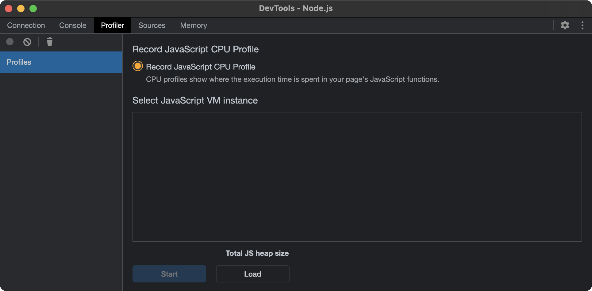
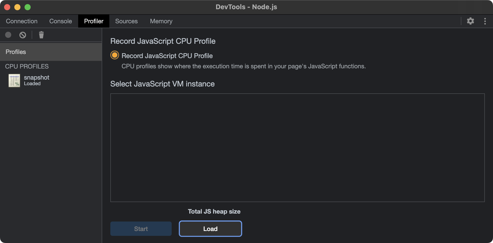
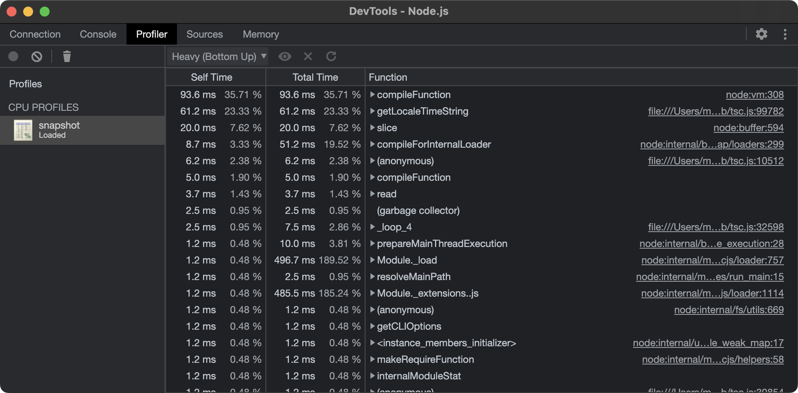
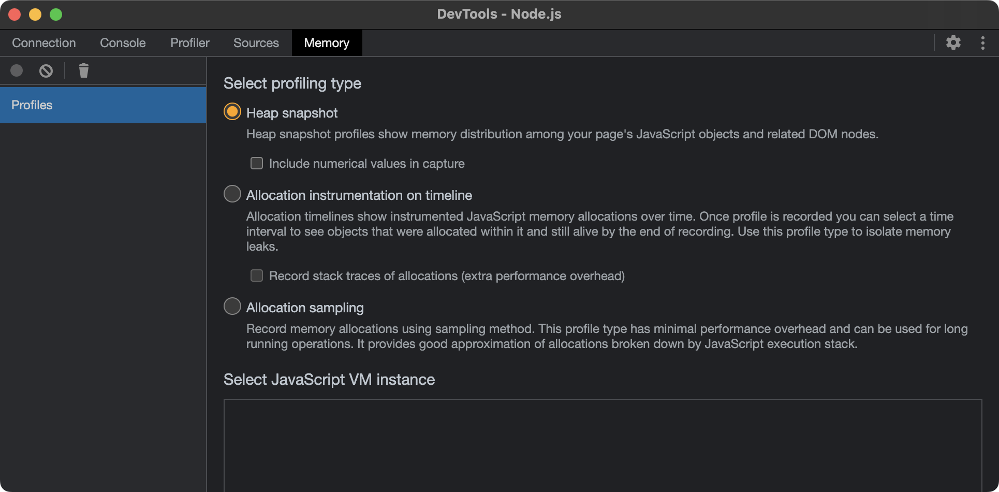
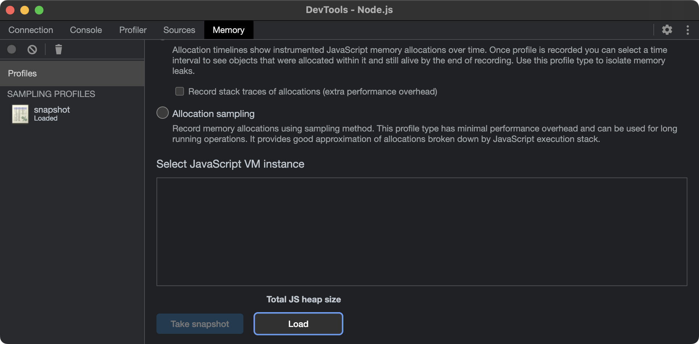
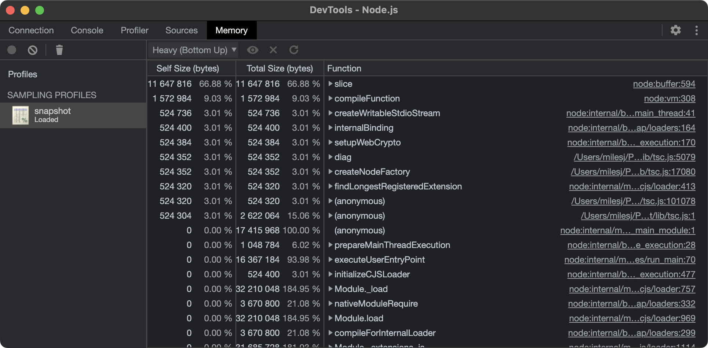
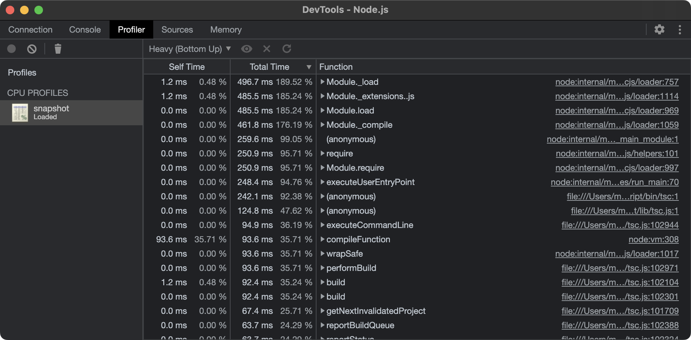
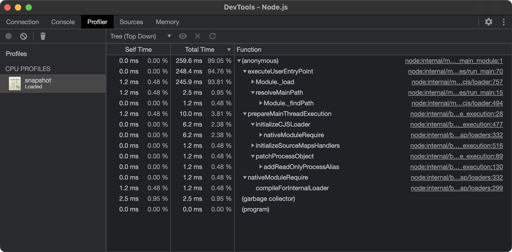
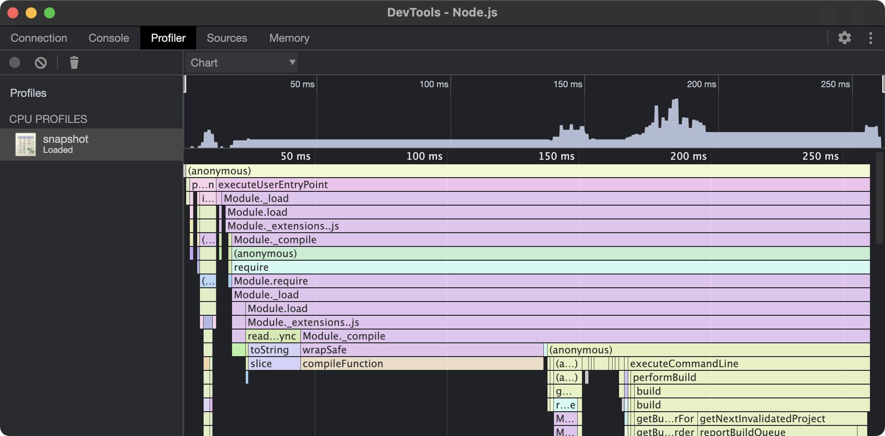

import { ConfigTabs } from "@/components/ConfigTabs";

Troubleshooting slow commands or unperformant tasks? Profile and diagnose them with ease!

Before reaching for a profiler, figure out _where_ the time goes, as there are 2 very different
answers, with different tools:

- **moon itself** - Building the project and task graphs, hashing inputs, calling toolchain plugins,
  installing dependencies, or reading from and writing to the cache. Profile these with a
  [trace](#profiling-moon).
- **The task's own process** - The command a task runs, like a build or a test suite, which moon
  only spawns and waits on. Profile these with the profiler of the task's language, like the
  [V8 profiler for Node.js](#profiling-nodejs-tasks).

## Profiling moon

### Recording a trace

Pass the global `--dump` option (or set the `MOON_DUMP` environment variable to `true`) to any
command, and moon writes a trace profile of the command to a `dump-<timestamp>.json` file in the
current working directory.

```shell
# Record a trace of running a task
$ moon run app:build --dump

# Record a trace in CI
$ MOON_DUMP=true moon ci
```

The trace is built from the same spans that power moon's [logging](../commands/overview.mdx#logging),
so it includes the entire run, from loading configuration and building the
[action graph](<../(fundamentals)/action-graph.mdx>), to running each action and calling plugins. It
respects the `--log` level, so keep it at the default `info` level or higher (`debug`, `trace`, or
`verbose`), as `warn`, `error`, and `off` exclude the spans from the trace.

### Analyzing a trace

Traces are written in the Chrome trace event format. Open them in
[Perfetto](https://ui.perfetto.dev/), or in Chrome by navigating to `chrome://tracing`, to inspect
the command as a timeline. Each bar is a span, nested under the span that created it, so long bars
stand out quickly. Select a span to see its duration, the fields recorded with it, and the location
in moon's source code that created it.

If you'd rather collect this data continuously, for example from every CI run, export it to an
observability backend with [OpenTelemetry](./opentelemetry.mdx) instead.

## Profiling Node.js tasks

The V8 profiler built into Node.js (enabled with the
[`--cpu-prof`](https://nodejs.org/api/cli.html#--cpu-prof) and
[`--heap-prof`](https://nodejs.org/api/cli.html#--heap-prof) flags) records 2 kinds of profiles:

- **CPU profiles** help you understand which parts of your code require the most CPU time, and how
  your code is executed and optimized by Node.js. The profiler measures code execution, and
  activities performed by the engine itself, such as compilation, calls of system libraries,
  optimization, and garbage collection.
- **Heap profiles** help you detect memory leaks and dynamic memory problems, and locate the
  fragments of code that caused them.

### With the Node.js toolchain

When a task's [`command`](/moon/api/TaskConfig#command) is `node` (or `nodejs`), the
[Node.js toolchain](../toolchains/javascript/node.mdx#profiling) can enable the profiler for you,
through its `profileExecution` setting, which accepts `"cpu"` or `"heap"`. As profiling is meant for
temporary debugging, enable it for a single project in its [`moon.config`](<../(fundamentals)/project.mdx>),
and remove it once you're done.

<ConfigTabs
  file="moon"
  config={{
    toolchains: {
      node: {
        profileExecution: "cpu",
      },
    },
  }}
  comments={{
    toolchains: "Profile this project's `node` tasks only",
  }}
/>

The profile is written to the project's `.moon` directory, as `snapshot.cpuprofile` or
`snapshot.heapprofile`, and each run overwrites the previous profile. The setting doesn't affect
task hashes, so a cached task is restored without running. Pass `--force` to
[`moon run`](../commands/run.mdx) to bypass the cache.

```shell
$ moon run app:build --force
```

### With `NODE_OPTIONS`

Tasks that run Node.js indirectly, like `vitest`, `vite build`, or a package manager script, aren't
affected by `profileExecution`. For these, pass the profiler flags through the `NODE_OPTIONS`
environment variable, in the task's [`env`](/moon/api/TaskConfig#env).

<ConfigTabs
  file="moon"
  config={{
    tasks: {
      test: {
        command: "vitest run",
        env: {
          NODE_OPTIONS: "--cpu-prof --cpu-prof-dir=.profiles",
        },
      },
    },
  }}
/>

Every Node.js process the task spawns, including worker processes, writes its own profile to the
directory, named like `CPU.20260101.120000.12345.0.001.cpuprofile`. Relative paths are resolved from
the task's working directory, which is the project root by default. Use `--heap-prof` and
`--heap-prof-dir` for heap profiles instead. Changing a task's `env` changes its hash, so the task
runs again without needing `--force`.

<Callout type="warning">
  Older versions of Node.js reject `--cpu-prof` in `NODE_OPTIONS`, with a "not
  allowed in NODE_OPTIONS" error (22.14 does, while 22.17 and later accept it).
  If you're on an older version, call `node` with the flags directly, as a
  task's command.
</Callout>

### Other languages

The same approach works for any language whose profiler is enabled through arguments or environment
variables. Pass the flags through the task's [`args`](/moon/api/TaskConfig#args), or set the
variables in its [`env`](/moon/api/TaskConfig#env), and write the profile to a known location
(ideally one that's ignored by Git).

## Analyzing in Chrome

CPU and heap profiles can be reviewed and analyzed with
[Chrome developer tools](https://developer.chrome.com/docs/devtools/).

<Callout>
  On macOS, press `command` + `shift` + `.` in the file picker to display hidden
  files and folders, like the `.moon` directory.
</Callout>

### CPU profiles

1. Open Chrome and navigate to `chrome://inspect`.
2. Under "Devices", navigate to "Open dedicated DevTools for Node".
3. The following window will popup. Ensure the "Profiler" tab is selected.

   

4. Click "Load" and select the `.cpuprofile` file that was recorded. If successful, the profile will
   appear in the left column.

   

5. Select the profile in the left column. From here, the profile can be analyzed and represented
   with [Bottom up](#bottom-up), [Top down](#top-down), or [Flame chart](#flame-chart) views.

   

### Heap profiles

1. Open Chrome and navigate to `chrome://inspect`.
2. Under "Devices", navigate to "Open dedicated DevTools for Node".
3. The following window will popup. Ensure the "Memory" tab is selected.

   

4. Click "Load" and select the `.heapprofile` file that was recorded. If successful, the profile
   will appear in the left column.

   

5. Select the profile in the left column. From here, the profile can be analyzed and represented
   with [Bottom up](#bottom-up), [Top down](#top-down), or [Flame chart](#flame-chart) views.

   

### Views

Chrome DevTools provide 3 views for analyzing activities within a profile. Each view gives you a
different perspective on these activities.

#### Bottom up

The Bottom up view is helpful if you encounter a heavy function and want to find out where it was
called from.

- The "Self Time" column represents the aggregated time spent directly in that activity, across all
  of its occurrences.
- The "Total Time" column represents aggregated time spent in that activity or any of its children.
- The "Function" column is the function that was executed, including source location, and any
  children.



#### Top down

The Top down view works in a similar fashion to [Bottom up](#bottom-up), but displays functions
starting from the top-level entry points. These are also known as root activities.



#### Flame chart

DevTools represents main thread activity with a flame chart. The x-axis represents the recording
over time. The y-axis represents the call stack. The events on top cause the events below it.


